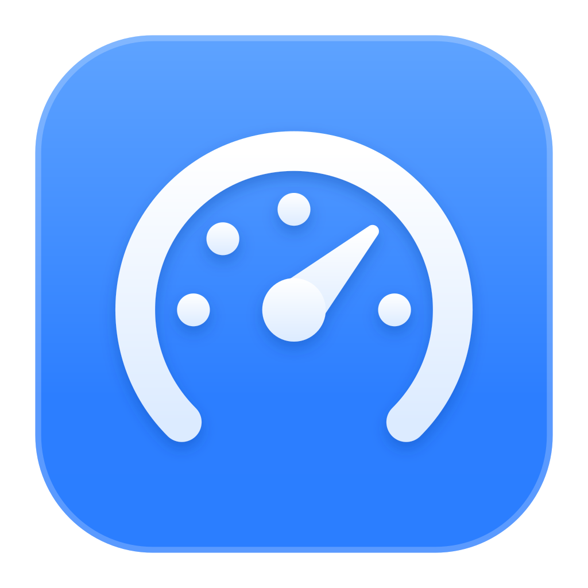

<p align="center">
  
</p>

<h1 align="center">Quota</h1>

<p align="center">
  <b>Your AI usage limits and what they cost, at a glance.</b><br>
  A <a href="https://github.com/ManyGlue0/Holster">Holster</a> app: hover its tile to see how close you are to every limit, click it for the whole picture.
</p>

<p align="center">
  
  <a href="https://github.com/ManyGlue0/Holster"></a>
  
  
  <a href="LICENSE"></a>
</p>

<p align="center">
  
  
</p>

---

Claude, Codex, Cursor, Copilot, Grok, Muse Code and more each meter you differently: a 5-hour
session here, a weekly pool there, monthly credits somewhere else. Quota reads them all from the
logins already on your PC and puts them in one place, with what your usage would cost at API rates.
Nothing to set up: if a tool is signed in on this machine, Quota finds it.

Quota is a Windows take on [OpenUsage](https://github.com/robinebers/openusage) (macOS): its
provider research, pricing data, spend scanners and popover design are ported here. Quota is not
OpenUsage and isn't affiliated with it.

> [!NOTE]
> Quota is **Windows 11 only** and lives in the [Holster](https://github.com/ManyGlue0/Holster)
> dock. Without Holster it still works from its tray icon and `Ctrl+Alt+U`.

## Highlights

- **Every limit, colored by pace.** Each limit is a bar: blue when you're on course, amber when
  you'll land close to it, red when you'll run out before it resets, with the time you'll hit it.
  The bar is judged by your burn rate, not just how full it is.
- **What it costs.** Today, yesterday and the last 30 days, as a ring of each provider's share in
  its brand color, by cost or by tokens. Every provider card has a 30-day trend and the same
  periods under its caret.
- **A glance from the dock.** Hover Quota's tile and the preview shows your fullest limits and
  today's spend. It's a page on disk, so it shows the last numbers even while Quota is closed.
- **Checks only when you look.** By default nothing runs in the background: hovering the tile or
  opening the panel asks for fresh numbers. Or pick every 5 or 15 minutes and get Holster
  notifications: as many as you like, each for any limit or just the 5-hour, weekly or monthly one,
  at the percentage you choose. They say when you'll run out at your pace, and when it resets.
- **Your logins stay yours.** Claude and Muse Code are asked through their own official tools; no
  token is read. API keys you paste are kept in Windows Credential Manager. See
  [How it reads your usage](#how-it-reads-your-usage).
- **Native and light.** Real acrylic, light and dark themes, spring animations. One small Rust
  process.

<p align="center">
  
  
</p>

## Providers

| Provider | Limits | Spend | Where Quota gets it |
|---|---|---|---|
| **Claude** | 5-hour session, weekly, per-model weekly (Fable on Max) | ✓ | Asks Claude Code itself (`claude -p /usage`) |
| **Codex** | 5-hour, weekly or monthly, model limits, reset credits, credits | ✓ | The Codex CLI's ChatGPT sign-in (`~/.codex/auth.json`) |
| **Cursor** | Billing-cycle total, Cursor and other model pools, on-demand | ✓ | The Cursor app's sign-in |
| **Copilot** | Monthly AI credits, extra usage; chat and completions on free plans | | The GitHub CLI (`gh auth token`) or Copilot's editor plugins |
| **Devin** | Daily, weekly, extra-usage balance | | The Devin CLI or app's sign-in |
| **Grok** | Weekly credit pool, pay-as-you-go cap | ✓ | The Grok CLI's sign-in (`~/.grok/auth.json`) |
| **Muse Code** | 5-hour and weekly windows | | Asks Muse Code itself (`muse serve`) |
| **Ollama** | Monthly credits (or session and weekly on older plans), purchased credits | | Signs requests with Ollama's own key, like the Ollama CLI |
| **OpenCode** | Go: 5-hour, weekly, monthly | ✓ | OpenCode's local data |
| **OpenRouter** | Credits, key cap; spend today, this week, this month | | An API key you paste in Settings (or `OPENROUTER_API_KEY`) |
| **Z.ai** | GLM Coding Plan session and weekly, web searches | | An API key you paste in Settings (or `ZAI_API_KEY`) |

A provider turns itself on the first time Quota finds its login on your PC. After that it's
yours to switch in Settings, and Quota never turns it back on. Ollama is the exception: its key
exists whether or not you use Ollama Cloud, so you turn it on yourself.

**Spend** is an estimate at API rates, measured from the token counts in each tool's local logs:
what that usage would cost on the API, not your subscription bill. Grok and OpenCode record their
own costs, and those are used as-is. Models no price list knows are left out and named under the
card's caret.

## Install

### Download

1. Install [Holster](https://github.com/ManyGlue0/Holster#install) if you haven't.
2. Get `Quota_<version>_x64-setup.exe` from the **[latest release](https://github.com/ManyGlue0/Quota/releases/latest)**
   and run it. It installs for the current user (no admin rights needed), starts with Windows, and
   adds its tile to Holster's dock on its own.

The installer isn't code-signed, so Windows SmartScreen may warn you the first time: click
**More info**, then **Run anyway**.

To update, run a newer installer over the old one. Your settings live in
`%APPDATA%\app.quota.desktop` and are kept.

### Build it yourself

1. Install the tools once:
   - [Visual Studio Build Tools](https://visualstudio.microsoft.com/visual-cpp-build-tools/) with the **Desktop development with C++** workload.
   - [Rust](https://rustup.rs), with the default options (stable, MSVC).
   - [Node.js](https://nodejs.org) 20 or newer, then [pnpm](https://pnpm.io/installation) (`npm install -g pnpm`).
2. Get the code and build the installer:

   ```sh
   git clone https://github.com/ManyGlue0/Quota.git
   cd Quota
   pnpm install
   pnpm tauri build
   ```

3. The installer is in `src-tauri\target\release\bundle\nsis\`. Run it like the downloaded one.

## Using it


- **Glance**: rest on Quota's tile in Holster. The preview shows the three providers closest to a
  limit and today's spend.
- **Open the panel**: click the tile, press `Ctrl+Alt+U`, or click the tray icon. It unfolds
  from the tile you clicked and is as tall as its content.
- **Read a limit**: click its value to flip between used and left, and its reset to flip between
  a countdown and the exact time. The caret on a card opens today, yesterday and the last 30 days.
- **Total spend**: switch Today, Yesterday and 30 Days, and Cost or Tokens from the title.
- **Close it**: click outside, press `Esc` or the shortcut again. The pin keeps it open.
- **Settings**: the button at the bottom of the panel, the tray menu, or `quota.exe --settings`.
  Providers on or off, API keys, when to check (when I look, every 5 or 15 minutes),
  notifications (out of the box: any limit at 80% and when it runs out), theme, shortcut, and
  launch at startup.

<br clear="right">

## How it reads your usage

Quota reads only what each tool already keeps on your PC, and sends a login only to that
provider's own service.

- **Claude: your login is never touched.** Quota runs the real Claude Code, headless and
  windowless, with its built-in `/usage` command and reads what it prints. `/usage` is a local
  command: no model request, nothing counted against your limits. The run is kept out of your
  session history and skips MCP servers and hooks. Claude Code signs in and renews its own token,
  as always.
- **Muse Code works the same way.** Quota starts Muse Code's own local host (`muse serve`) and
  calls its documented `usage/read`, which reports your windows without a model call.
- **The others** are read with the login their tool keeps, as OpenUsage does. Several of these
  services are internal ones the tools themselves call, so they can change without notice. If a
  provider stops working, please [open an issue](https://github.com/ManyGlue0/Quota/issues).
  - Codex and Grok tokens are renewed only when they're about to expire. The new token is written
    back into the tool's own file, touching only the token fields, and only if the file still
    holds the login Quota read.
  - Cursor's, Devin's and OpenCode's databases are opened read-only.
  - Copilot's token comes from `gh auth token`. Quota never reads gh's credential vault itself.
  - Ollama's private key never leaves your PC. Requests carry only a signature, like the Ollama
    CLI's.
  - OpenRouter and Z.ai keys you paste are stored in Windows Credential Manager, encrypted for your
    Windows user, never in Quota's files.
- **Not too often.** A provider is asked at most every 15 seconds, numbers under 30 seconds old
  aren't checked again, and a provider that rate-limits Quota is left alone until it says to come
  back.

## Your data

Everything lives in `%APPDATA%\app.quota.desktop\`: `settings.json` (your choices),
`usage.json` (the last known numbers, so the panel has something to show at once) and
`holster-preview\` (the page Holster shows on hover, its `state.json` and the tile's mark).
Spend is computed on your PC from local logs; nothing about your usage is sent anywhere except
each provider's own requests.

## Development

```sh
pnpm install
pnpm tauri dev         # Vite + the app, with hot reload for the UI
pnpm tauri build       # installer at src-tauri/target/release/bundle/nsis/
cd src-tauri && cargo test
cargo test --release real_logs -- --ignored --nocapture           # scan this PC's logs
cargo test --lib real_new_providers -- --ignored --nocapture      # ask the providers signed in here
node scripts/normalize-logos.mjs   # refit scripts/logos/*.svg into src/assets/providers
pnpm app-icon                      # re-render the app icons from src-tauri/icons/quota-icon.svg
```

```
src-tauri/src/
  lib.rs         app setup: window, tray, hotkey, plugins
  shell.rs       the panel window: spring-animated native bounds, acrylic, focus
  holster.rs     Holster: manifest, preview page and state.json, loopback routes, notifications
  usage.rs       the poller: when to check, keeping the last good numbers, back-off, alerts
  providers/     one file per provider: where its login is, what it asks, how answers map to limits
  spend/         local log scanners (Claude, Codex, Grok, OpenCode), Cursor's export, pricing
  secrets.rs     API keys in Windows Credential Manager
  settings.rs    settings.json, and turning on providers found for the first time
src/             React + TypeScript UI (Framer Motion, Lucide)
src-tauri/holster-preview/   the preview page Holster shows on hover
src-tauri/resources/pricing/ model prices: OpenUsage's supplement, LiteLLM and models.dev snapshots
```

## Credits

Quota ports [OpenUsage](https://github.com/robinebers/openusage) by Robin Ebers (MIT). Model prices
come from [LiteLLM](https://github.com/BerriAI/litellm) and [models.dev](https://models.dev).
Provider logos are their owners' trademarks, used only to identify each provider. Details are in
[THIRD_PARTY_NOTICES.md](THIRD_PARTY_NOTICES.md).

## License

[MIT](LICENSE)
